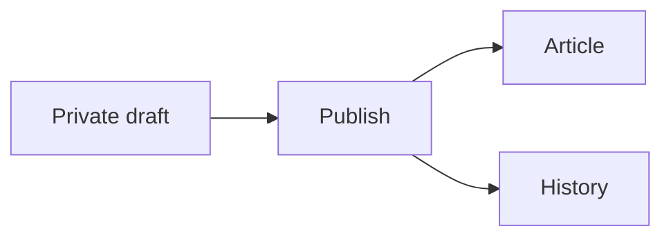

# 内容平台使用与恢复说明

本轮在 `feat/writing-workflow` 完成以下 13 项功能，保持 Astro + React + SQLite，以及独立域名和 `/howielog` 两种部署方式。朋友仓库的 PR #13 保持关闭，本轮没有改动其 `source.json` 或执行上线。

| 功能 | 使用入口与行为 |
| --- | --- |
| 1. 文章回收站 | Blog → Trash；Content tools → Trash 恢复。保留 30 天，恢复为未发布文章，保留正文、工作草稿、图片引用和版本历史。永久删除会清除文章相关记录，图片仍需单独检查引用后清理。 |
| 2. 完整备份 | Content tools → Backups；数据库、全部上传图片和校验清单组成一套备份，可预览数量再恢复；每日备份需要手动开启。 |
| 3. 媒体库 | Content tools → Media；按原文件名搜索，查看尺寸、占用和引用。文章、工作草稿、历史、回收站、项目或 Now 页面仍有引用时禁止删除。 |
| 4. 系列与阅读路径 | Content tools → Series 创建简介，在文章编辑器选择系列及章节顺序，后台可上下调整章节。公开目录只列已发布且非隐藏文章。 |
| 5. 导入导出 | Blog → Import Markdown / ZIP；每篇文章的 Export 下载 Markdown 与本地图片 ZIP。导入只建立私密工作草稿，不会覆盖同名文章或自动发布。 |
| 6. 定时发布 | Content tools → Schedules 选择已保存草稿及本机时区时间。编辑草稿会取消计划；取消和失败状态可查看，失败仍保留草稿。 |
| 7. 搜索 | Ctrl/Cmd+K 或页脚 Search；标题及摘要高亮，Blog 可叠加年份、系列、标签过滤，筛选条件反映在 URL。 |
| 8. 阅读偏好 | 文章 Bookmark、Continue reading 和 Text size；收藏列表 `/bookmarks`。仅保存在当前浏览器，支持相同浏览器的跨标签页同步。 |
| 9. 正文增强 | Mermaid 流程图等图表、代码文件名和指定行高亮、图片点击或键盘放大。错误图表保留源码；弹窗支持 Escape 与焦点返回。 |
| 10. 内容关联 | 按共同系列或标签显示相关文章，展示内部文章反向引用；改 slug 后旧地址 308 跳到当前地址。后台 Links 报告不存在、删除或未发布的内部目标。 |
| 11. 项目复盘 | Projects 编辑地址、Markdown 正文及完成日期；`/projects/<slug>` 展示架构、决策、复盘，以及已有 demo / 源码链接。 |
| 12. Now | Content tools → Now 编写并发布 Markdown；`/now` 同时展示最近状态和未完成项目。 |
| 13. 年度回顾 | `/review` 与 `/review/<year>` 汇总公开文章、当年完成项目、主题标签及当年公开文章的近似访问量。 |

## 写作与阅读

代码示例：

````markdown
```ts title="server.ts" {2,4-6}
const draft = await saveDraft();
await validate(draft);
const backup = await createBackup();
await publish(draft);
```


````

Mermaid 按需加载、串行渲染；单图最多 10,000 字符和 200 条边。使用 strict 模式及额外 SVG 清理，禁止作者覆盖配置、HTML 标签、外部 SVG 图片和点击链接。大型图表依赖仍有较大的构建分块，普通无图文章不会加载 Mermaid。数学公式、代码复制和原有目录保持可用。

收藏上限 100 篇；阅读位置按文章 ID 保存，改地址后收藏仍可通过旧 slug 跳转。清理浏览器存储会移除收藏、位置和字号，不提供账户同步。文章转为草稿或放入回收站后，旧地址也停止公开跳转；已经被读者下载的内容无法追回。

系列可从现有文章迁移生成；导入的新系列在发布时补建。调整章节顺序也会更新文章版本，已打开的旧工作草稿会提示冲突，防止覆盖新的顺序。工作草稿和回收站计入后台容量，但不会进入公开搜索、RSS、站点地图和年度汇总。

定时任务每 30 秒检查一次，每批最多 10 篇。服务停止期间不会发布；重启后处理到期计划。新文章用计划时刻作为发布日期，已有文章更新保留原发布日期。发布依旧检查草稿版本和文章基线版本，不会覆盖其他标签页已提交的内容；失败后可修改草稿并重新安排。服务器时钟应同步。

## Markdown 与图片迁移

支持 UTF-8 `.md`，或包含一份 Markdown 及其相对图片路径的 ZIP。支持常见行内图片和引用式图片；可使用 `<images/my image.png>` 包住带空格的路径。示例：

```yaml
---
title: 我的文章
slug: my-article
description: 简介
tags: [Astro, SQLite]
series: building-blog
seriesOrder: 1
publishedAt: '2026-10-25T00:00:00.000Z'
coverImage: images/cover.png
---
```

- 上传和 ZIP 解压后总量分别最多 32 MiB；最多 100 个条目、一份 Markdown、99 张引用图片，每条目最多 8 MiB。
- Markdown 文件最多 2 MiB，正文最多 500,000 字符，YAML 前置数据最多 16,384 字符；禁用 YAML 别名展开。
- 拒绝越界路径、绝对路径、反斜杠路径、重复文件、符号链接、加密 ZIP 和过大的解压内容。文件留在内存中解析，不解压到任意磁盘路径。
- 本地图片经过现有上传解码和 WebP 重编码，不保留原格式及 EXIF。远程 HTTP(S) 图片不在服务器下载，继续使用原 URL。
- 导入失败会撤销临时草稿并清理本次已上传且没有引用的图片。单进程一次处理一个导入或导出，避免批量缓冲叠加。
- 导出保留文章元数据和正文，附带正文及封面引用的本地图片；外部图片、历史版本和站点其他数据不在单篇导出内。超过 ZIP 限制时使用完整备份。

## 备份与恢复

生产使用绝对持久路径：`DATABASE_PATH`、`MEDIA_DIR`、可选 `FULL_BACKUP_DIR`。媒体默认在数据库旁的 `media/`；完整备份默认在 `${DATABASE_PATH}.full-backups/`。Linux 服务账户需要这些目录的读写权限，并位于 systemd `ReadWritePaths` 范围内。文件不允许由 Caddy 静态公开。备份包含非公开内容及数据库中的会话/内部密钥，按私密资料保管，异机传输及保存应加密。

在线维护仅支持**单应用进程**。备份和恢复期间排空进行中的 API 写入，新写入返回可重试的 503；正在自动保存的编辑器保留本地工作副本。不要绕过应用并行执行媒体删除、数据库迁移或其他写入。正常浏览仍可读取数据库，但恢复事务和完整性检查可能造成短暂停顿。

1. 点击 Create full backup。应用通过 SQLite backup API 取得一致快照，再复制快照媒体表中的所有图片，记录 SHA-256。未成功的临时目录会清理。
2. 把整套 UUID 目录复制到异机；只复制 `data.db` 不构成完整备份。备份目录包含 `manifest.json`、`data.db` 和 `media/`。运行环境的管理员密码 hash、Caddy/systemd 配置仍需单独保管，它们不在数据库里。
3. 恢复前选择 Check and preview restoration。应用校验数据库及媒体清单、SHA-256、数据库完整性、外键和 schema，展示当前及备份的文章/草稿/图片数量。
4. 输入完整备份 ID 后恢复。应用再次验证备份，补回缺失且可从备份找回的图片，创建当前状态的完整安全备份，再在事务中替换数据。恢复按外键依赖顺序执行，避免重新累计访问/反应汇总，并重建搜索索引；事务失败恢复原数据及触发器。
5. 成功后所有管理员会话失效，重新登录；备份中的待发布计划被取消，需要重新检查和安排。迁移 009 后还会撤销预览分享、清除远端自动备份设置，并保留当前通行密钥及计数器，避免恢复旧授权。核验文章、图片、历史、搜索、统计、项目及 Now 页面。

备份 schema 必须与当前程序一致；旧版本备份先在隔离环境使用兼容版本恢复，再执行迁移。若已有 UUID 图片与备份字节不同，在线恢复会停止，需先在离线副本排查，避免覆盖当前文件。当前数据库引用的缺失图片若不在所选备份中，无法生成完整安全备份，恢复会停止。恢复不会删除当前目录中额外的媒体文件，防止破坏其他恢复点；这些文件的离线清理需另行核对。

每日备份默认关闭；开启后每 24 小时最多尝试一次，失败原因在后台展示，可手动重试。自动淘汰也默认关闭；迁移 009 后可在 Site health 预览并开启自动备份保留策略，以及配置 restic 加密异机备份，详见 [写作与运维增强](PUBLISHING-OPERATIONS.md)。手动及安全备份始终保留，仍须监控磁盘容量并定期恢复演练。现有部署器的迁移前备份仍仅包含 SQLite，首次升级到此版本前仍需停写并共同备份数据库和图片。

## 验证边界

本地隔离数据库覆盖迁移、回收站隐私、系列、旧地址、媒体引用、定时发布、恶意 ZIP、导出再导入、备份校验、包含访问/反应汇总的完整恢复以及恢复中途失败回滚。生产 HTTP 测试同时覆盖独立域名及 `/howielog`、鉴权、CSRF、资源前缀和备份后重新登录。

这些功能已在 Windows 本地环境验证；真实 Linux/systemd、共享域名反向代理、备份磁盘和生产负载仍须在上线前演练。没有恢复朋友仓库 PR，也没有变更真实服务器。
